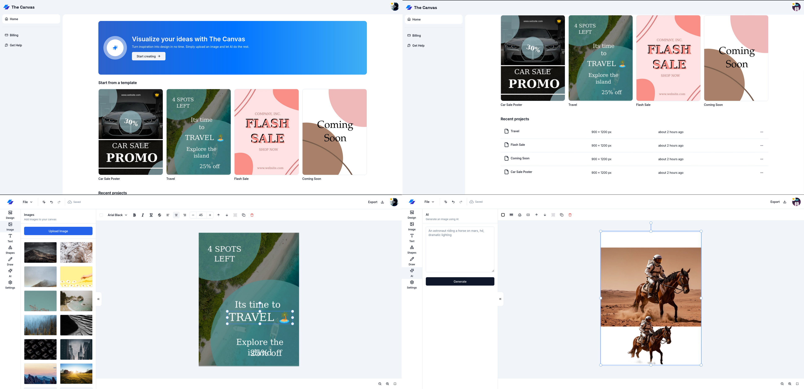

# 🎨 Canva Clone - Full-Featured Graphic Design SaaS Platform



A production-ready graphic design SaaS platform with an intuitive drag-and-drop editor, AI-powered features, and complete subscription management. Built with Next.js 14, Fabric.js canvas engine, Replicate AI, and Stripe payments.

---

## 🚀 Quick Start

**New to this project?** Follow our step-by-step setup guide:

### 📖 [Complete Setup Documentation](./docs/README/)

Start here: **[00-PREREQUISITES.md](./docs/README/00-PREREQUISITES.md)**

**Estimated setup time:** ~90 minutes

---

## ✨ Key Features

- 🎨 **Professional Design Editor** - Templates, text, shapes, drawing tools, and layers
- 🤖 **AI-Powered Tools** - Image generation and background removal
- 🔐 **Multi-Auth** - Google, GitHub, and Email/Password
- 💳 **Stripe Subscriptions** - Complete payment management
- 📤 **Export Options** - PNG, JPG, SVG, JSON
- 📱 **Fully Responsive** - Works on all devices
- 🔍 **Project Management** - Create and organize multiple projects
- 🎯 **Unsplash Integration** - Millions of free stock photos

---

## 🛠️ Tech Stack

**Frontend:** Next.js 14, React 18, TypeScript, TailwindCSS, Shadcn UI, Fabric.js  
**Backend:** Hono.js, Drizzle ORM, Neon PostgreSQL, Auth.js  
**AI & Media:** Replicate AI, Unsplash, UploadThing  
**Payments:** Stripe  
**State:** Zustand, TanStack Query

---

## 📋 Prerequisites

Before starting, you need:
- Node.js (v18+) or Bun
- Git
- Free accounts for: Neon, UploadThing, Replicate, Unsplash, Stripe, Google, GitHub

**👉 See [Prerequisites Guide](./docs/README/00-PREREQUISITES.md) for details**

---

## 🎯 Setup Guide

Follow these guides in order:

1. **[Prerequisites](./docs/README/00-PREREQUISITES.md)** - What you need (2 min)
2. **[Installation](./docs/README/01-INSTALLATION.md)** - Clone and install (5 min)
3. **[Database Setup](./docs/README/02-DATABASE-SETUP.md)** - Neon PostgreSQL (10 min)
4. **[Unsplash API](./docs/README/03-UNSPLASH-API.md)** - Stock photos (5 min)
5. **[UploadThing API](./docs/README/04-UPLOADTHING-API.md)** - File uploads (5 min)
6. **[Replicate API](./docs/README/05-REPLICATE-API.md)** - AI features (10 min)
7. **[Stripe Setup](./docs/README/06-STRIPE-SETUP.md)** - Payments (20 min)
8. **[Templates Setup](./docs/README/07-TEMPLATES-SETUP.md)** - Design templates (15 min)
9. **[GitHub OAuth](./docs/README/08-GITHUB-OAUTH.md)** - GitHub login (5 min)
10. **[Google OAuth](./docs/README/09-GOOGLE-OAUTH.md)** - Google login (10 min)
11. **[Deployment](./docs/README/10-DEPLOYMENT.md)** - Deploy to Vercel (15 min)

**Need help?** Check [Troubleshooting Guide](./docs/README/11-TROUBLESHOOTING.md)

---

## 📦 Quick Commands

```bash
# Install dependencies
bun install

# Setup database
bun run db:generate
bun run db:migrate

# Start development
bun dev

# Open database GUI
bun run db:studio
```

**Full command reference:** See [Installation Guide](./docs/README/01-INSTALLATION.md)

### Webhook concurrency test

Stripe can deliver webhook events late, twice, or out of order. `npm run test:race` runs the Stripe webhook's database writes in every possible order on a real Postgres with [VibeRaven](https://viberaven.dev) (`npx -y viberaven race`), and fails if any order breaks the rule in `drizzle/race/webhook.race.json`. It also runs in `npm test`. Add a rule there when you add a webhook handler.

---

## 🔧 Environment Variables

Create a `.env` file with these variables:

```env
DATABASE_URL=
AUTH_SECRET=
NEXT_PUBLIC_APP_URL=http://localhost:3000
NEXT_PUBLIC_UNSPLASH_ACCESS_KEY=
UPLOADTHING_SECRET=
UPLOADTHING_APP_ID=
UPLOADTHING_TOKEN=
REPLICATE_API_TOKEN=
STRIPE_SECRET_KEY=
STRIPE_PRICE_ID=
STRIPE_WEBHOOK_SECRET=
GITHUB_CLIENT_ID=
GITHUB_CLIENT_SECRET=
GOOGLE_CLIENT_ID=
GOOGLE_CLIENT_SECRET=
```

**Detailed guide:** [Environment Variables Reference](./docs/README/12-ENV-REFERENCE.md)

---

## 💎 Pro Features

Unlock with subscription:
- ✨ Unlimited projects
- 🎨 Premium templates
- 🤖 Unlimited AI generations
- 📤 High-resolution exports
- 💾 Priority support

---

## 📚 Documentation

- **[Setup Guides](./docs/README/)** - Complete step-by-step setup
- **[Troubleshooting](./docs/README/11-TROUBLESHOOTING.md)** - Common issues and solutions
- **[Environment Variables](./docs/README/12-ENV-REFERENCE.md)** - All variables explained

---

## 🎓 Learn More

- [Next.js Documentation](https://nextjs.org/docs)
- [Drizzle ORM Documentation](https://orm.drizzle.team/docs)
- [Auth.js Documentation](https://authjs.dev/)
- [Fabric.js Documentation](http://fabricjs.com/docs/)
- [Stripe Documentation](https://stripe.com/docs)
- [Replicate Documentation](https://replicate.com/docs)

---

## 🙏 Credits

**Course:** [YouTube/Original Tutorial](https://www.codewithantonio.com/projects/canva-clone) (18-hour course)  
**Creator:** [Code With Antonio](https://github.com/antonioerdeljac)  
**Deployment:** [Vercel](https://vercel.com/)  
**UI Components:** [Shadcn](https://ui.shadcn.com/)

---

## 📝 License

This project is based on the tutorial by Antonio Erdeljac.

---

## ⭐ Support

If you found this project helpful, please give it a star!

**Need help?** 
- Check [Documentation](./docs/NOTE.md)
- Review [Troubleshooting](./docs/README/11-TROUBLESHOOTING.md)
- Create an issue on GitHub

---

**Ready to start?** → Begin with **[Prerequisites Guide](./docs/README/00-PREREQUISITES.md)** 🚀